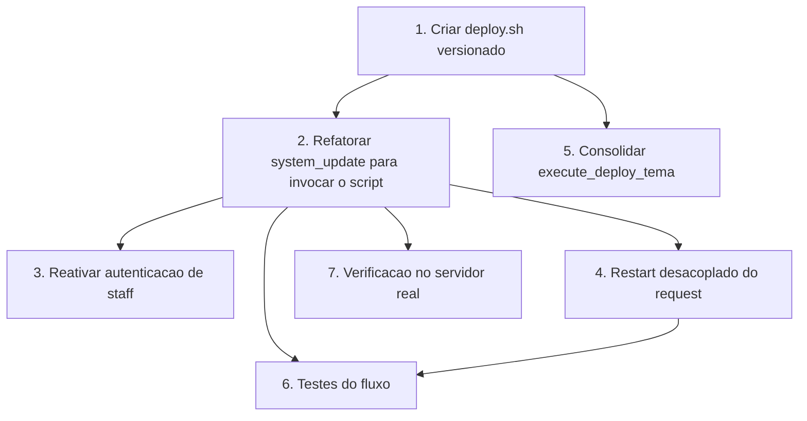

# Implementation Plan

## Overview

Esta spec implementa a **Opção B** do deploy automático: extrair os passos para um `deploy.sh` versionado e refatorar a view `system_update` para apenas invocá-lo, corrigindo os bugs do fluxo atual (captura de saída, autenticação, restart no request). O deploy é local.

## Task Dependency Graph

O script (tarefa 1) é a base; a refatoração da view (2) depende dele; as correções de segurança e restart (3, 4) podem andar junto com a 2; a consolidação do `execute_deploy_tema` (5) depende do script pronto; os testes (6) vêm por último. A tarefa 7 (verificação no servidor real) é manual e fecha o ciclo.



Legenda: setas sólidas são dependências rígidas (bloqueiam). A tarefa 7 é verificação manual em ambiente real e só pode ocorrer após o código estar pronto.

As ondas de execução (tarefas paralelizáveis por onda):

```json
{
  "waves": [
    {
      "wave": 1,
      "tasks": ["1"],
      "description": "Criar o script deploy.sh versionado — base de todo o fluxo"
    },
    {
      "wave": 2,
      "tasks": ["2", "3", "4", "5"],
      "description": "Refatorar a view, reativar auth, desacoplar restart e consolidar o deploy do tema"
    },
    {
      "wave": 3,
      "tasks": ["6"],
      "description": "Testes automatizados do fluxo (mockando os_run e os passos)"
    },
    {
      "wave": 4,
      "tasks": ["7"],
      "description": "Verificação manual em servidor real (git pull/migrate/restart de verdade)"
    }
  ]
}
```

## Tasks

- [x] 1. Criar `deploy.sh` versionado na raiz do projeto
  - Passos em ordem: `git pull` (projeto), `git pull` (tema, se existir), `migrate` e `collectstatic --noinput` com o Python do venv, restart do supervisor desacoplado
  - `set -euo pipefail` para abortar no primeiro erro e propagar código de saída
  - Parametrizar `PROJECT_DIR`, `VENV_DIR`, `SUPERVISOR_SERVICE` via variáveis de ambiente com defaults derivados
  - _Requisitos: 2.1, 2.2, 3.1, 3.2, 5.1, 5.3, 5.4, 5.5_

- [x] 2. Refatorar `system_update` para invocar o script
  - Substituir os passos in-process por `os_run(['bash', 'deploy.sh'], cwd=BASE_DIR)`
  - Montar o log a partir da saída do script (corrigindo o `TypeError` de `call_command` que retorna `None`)
  - Diferenciar sucesso (mensagem + log) de falha (mensagem com o passo + saída de erro)
  - _Requisitos: 5.2, 6.1, 6.2, 6.3_

- [x] 3. Reativar a autenticação de staff
  - Descomentar/aplicar `@staff_member_required` em `system_update` (e avaliar em `execute_deploy_tema`)
  - _Requisitos: 1.1, 1.2_

- [x] 4. Desacoplar o restart do request
  - Garantir no `deploy.sh` que o `supervisorctl restart` seja disparado de forma assíncrona (ex.: `setsid`/`nohup &`/`at`), permitindo a resposta HTTP sair antes do restart
  - Manter o gate de `DEBUG` (não reiniciar em desenvolvimento)
  - _Requisitos: 4.1, 4.2, 4.3_

- [x] 5. Consolidar `execute_deploy_tema`
  - Reutilizar o `deploy.sh` (ou subconjunto parametrizado) em vez de duplicar `git pull` do tema + `collectstatic`
  - Remover o bloco de código Fabric comentado
  - _Requisitos: 5.1, 5.2_

- [x] 6. Testes do fluxo de deploy
  - Teste da view com `os_run` mockado (invoca o script, exige staff, monta log em sucesso e falha)
  - Teste do gate de `DEBUG` (restart não incluído)
  - Teste de regressão do bug de concatenação (sem `TypeError`)
  - _Requisitos: 1.1, 4.3, 6.1, 6.2, 6.3_

- [ ] 7. Verificação em servidor real (manual)
  - Rodar o deploy em ambiente de teste com `git pull`/`migrate`/`collectstatic`/restart reais e confirmar que a resposta HTTP chega antes do restart
  - _Requisitos: 2.1, 2.2, 3.1, 3.2, 4.1, 4.2_
